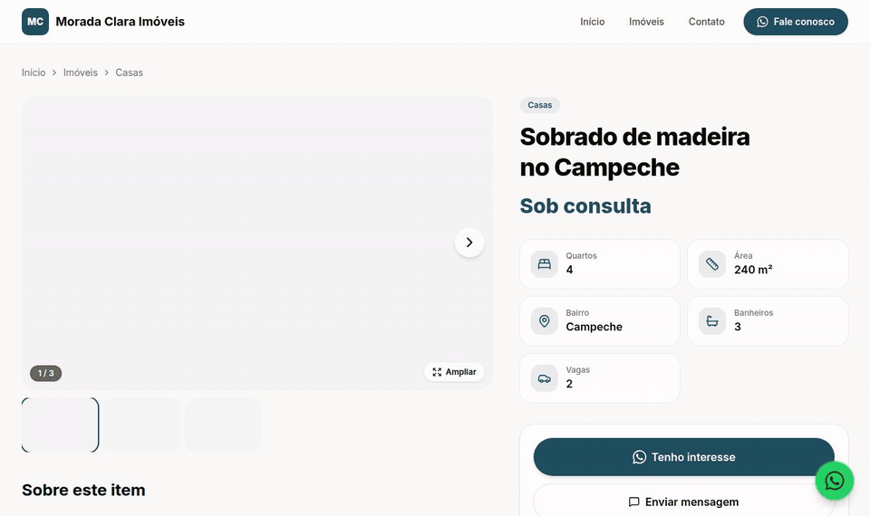
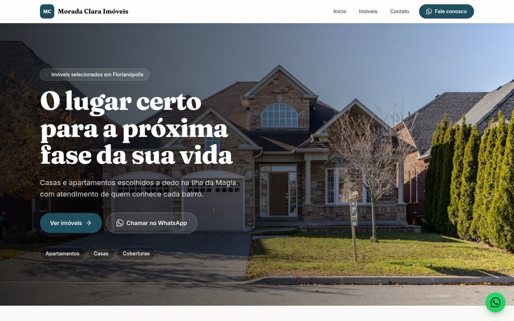
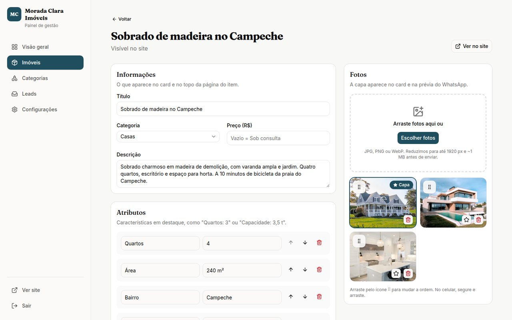
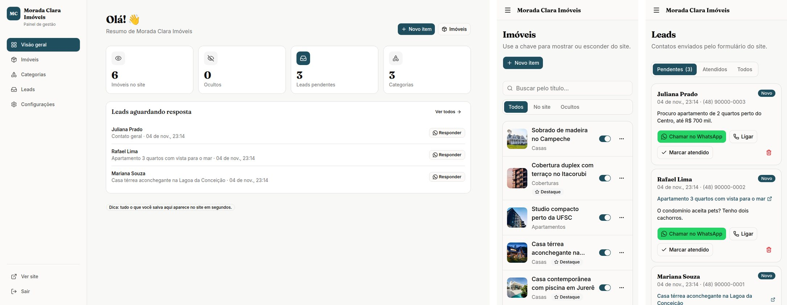
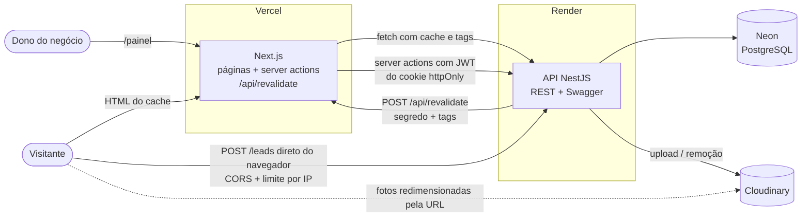
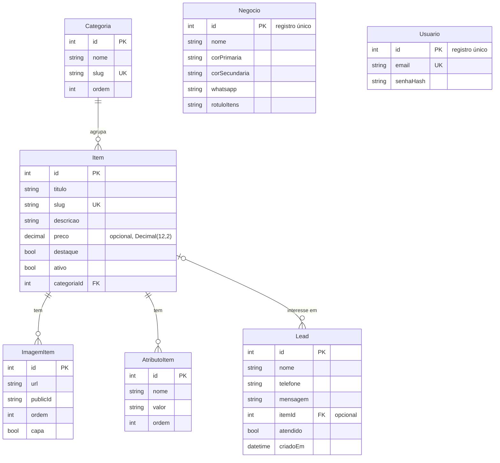

# Vitrine: site + painel para pequenos negócios

[](https://github.com/Pedrovizkyh/vitrine-template/actions/workflows/ci.yml)

Um template para colocar no ar, em um dia, o site de um pequeno negócio que vende ou anuncia
"itens": imóveis, serviços, veículos, produtos. O dono edita tudo por um painel, e o site se
atualiza na hora. O contato chega pelo WhatsApp ou por um formulário que vira lead no painel.

| Demo | Site | Painel | API (Swagger) |
| --- | --- | --- | --- |
| 🏠 Imobiliária *Morada Clara* | [vitrine-imobiliaria.vercel.app](https://vitrine-imobiliaria.vercel.app/) | [/painel](https://vitrine-imobiliaria.vercel.app/painel/login) | [Swagger](https://vitrine-api-imobiliaria.onrender.com/docs) |
| 🚛 Guincho *Reboque Ágil 24h* | [vitrine-guincho-psi.vercel.app](https://vitrine-guincho-psi.vercel.app/) | [/painel](https://vitrine-guincho-psi.vercel.app/painel/login) | [Swagger](https://vitrine-api-guincho.onrender.com/docs) |

**Login das demos:** `admin@demo.com` / `demo1234` (os dados voltam ao original quando o seed roda de novo).

> As duas demos rodam o **mesmo código**: só mudam a configuração do negócio e o seed.
> A API fica no plano gratuito do Render e pode levar ~50 s para acordar no primeiro acesso.

### Do painel para o site, na hora



### As duas demos

| [Imobiliária](https://vitrine-imobiliaria.vercel.app/) | [Guincho](https://vitrine-guincho-psi.vercel.app/) |
| --- | --- |
| [](https://vitrine-imobiliaria.vercel.app/) | [](https://vitrine-guincho-psi.vercel.app/) |

No celular: home e página do item de cada demo.


### Painel





### Lighthouse (mobile)


Rodado localmente (`next start` + API local, Lighthouse 12, emulação mobile com 4G lento):

| Página | Performance | Acessibilidade | Boas práticas | SEO |
| --- | :-: | :-: | :-: | :-: |
| `/` (home) | 92 | 100 | 100 | 100 |
| `/itens` | 92 | 100 | 100 | 100 |
| `/[slug]` (página do item) | 92–93 | 100 | 100 | 100 |
| `/contato` | 95 | 100 | 100 | 100 |

---

## O que tem

**Site público**
- Home com hero forte, destaques, categorias, "sobre" e chamada final
- Listagem com filtro por categoria (`/itens?categoria=casas`) e paginação
- Página do item com URL amigável (`/casa-terrea-com-quintal`), galeria com swipe e zoom,
  atributos em destaque, botão "Tenho interesse" no WhatsApp e itens relacionados
- Contato com formulário (vira lead), mapa carregado só quando aparece na tela
- Botão flutuante do WhatsApp com mensagem pronta (muda conforme a página)
- Tema a partir das cores do negócio, com contraste do texto calculado automaticamente
- SEO: `generateMetadata` em todas as páginas, Open Graph com a foto de capa, JSON-LD,
  `sitemap.xml`, `robots.txt` bloqueando o painel

**Painel** (`/painel`, funciona bem no celular)
- Visão geral com contadores e leads pendentes
- Itens: busca, filtro, ativar/desativar, destacar, excluir
- Formulário de item com atributos livres (`useFieldArray`), sugestões por nicho
- Fotos: várias de uma vez, com prévia, compressão no navegador, capa e ordem por arrastar
- Categorias, leads (filtro por atendido + link direto para o WhatsApp do cliente)
- Configurações do negócio com prévia ao vivo das cores e do contraste

## Stack

| Camada | Tecnologias |
| --- | --- |
| API (`api/`) | NestJS 12, Prisma 7 + PostgreSQL, JWT (passport), bcrypt, Multer, Cloudinary, @nestjs/throttler, Swagger, Zod (env) |
| Web (`web/`) | Next.js 16 (App Router, Cache Components), React 19, Tailwind CSS 4, shadcn/ui, Lucide, React Hook Form + Zod, dnd-kit, Sonner |
| Testes | Vitest (+ SWC para os decorators do Nest), Supertest, banco de teste em container |
| Infra | Neon (Postgres), Render (API), Vercel (site), Cloudinary (fotos), GitHub Actions (CI) |

## Arquitetura



Fluxo de uma edição: o dono salva no painel → server action do Next chama a API com o token →
a API grava no banco e chama `/api/revalidate` com as tags afetadas (`itens`, `item-<slug>`...) →
o Next descarta só aquele cache → a próxima visita já vê a mudança.

## Modelo de dados



## Rodando localmente

Pré-requisitos: Node 22+ e Docker (ou Podman com `podman-compose`).

```bash
# 1. Bancos: dev na porta 5440 e teste na 5441
docker compose up -d

# 2. API
cd api
cp .env.example .env          # ajuste se quiser; Cloudinary é opcional no dev
npm install
npx prisma migrate deploy
npm run seed -- imobiliaria   # ou: npm run seed -- guincho  (APAGA e recria os dados)
npm run start:dev             # http://localhost:3001  · Swagger em /docs

# 3. Web (outro terminal)
cd web
cp .env.example .env.local    # REVALIDATE_SECRET igual ao da API
npm install
npm run dev                   # http://localhost:3000  · painel em /painel
```

Sem as chaves do Cloudinary, o seed usa as fotos direto do Unsplash e o upload pelo painel
responde "Cloudinary não configurado". Todo o resto funciona.

### Testes

```bash
cd api
npm test            # unitários: slug, atributos, validação de upload, capa única, env
npm run test:e2e    # e2e com Supertest no banco de teste (porta 5441): login, CRUD,
                    # rotas públicas só com ativos, leads, throttler, upload (Cloudinary mockado)
cd ../web
npm test            # schemas Zod do painel, contraste de cores, compressão, formatos, JWT
```

O CI (`.github/workflows/ci.yml`) roda lint, testes e build das duas partes a cada push e PR,
com um Postgres como service. O build da web roda com a API **inexistente** de propósito.

### Deploy

Passo a passo em [DEPLOY.md](DEPLOY.md): dois bancos no Neon, duas APIs no Render
([render.yaml](render.yaml)), dois projetos na Vercel, tudo do mesmo repositório.

## Decisões técnicas

- **Atributos livres em vez de colunas fixas.** "Quartos" faz sentido para imóvel, "Capacidade"
  para guincho. `AtributoItem (nome, valor, ordem)` atende qualquer nicho sem migration. Salvar
  substitui a lista inteira numa transação: ou tudo, ou nada.
- **Preço em `Decimal(12,2)`, nunca `Float`.** A API devolve como string para não perder centavos.
  Preço vazio vira "Sob consulta".
- **Slug estável.** Gerado do título (sem acentos, com `-2`, `-3` se repetir) e **não muda** quando
  o título é editado, para não quebrar links já compartilhados. Rotas existentes (`painel`,
  `contato`, `itens`, `sitemap.xml`...) são reservadas porque a página do item fica em `/[slug]`.
- **Cache Components + revalidação por tag.** Toda leitura pública passa por uma função
  `'use cache'` com `cacheTag`. A API avisa o Next quais tags mudaram; nada de revalidar por tempo.
  Se a API estiver fora, o erro é cacheado por poucos minutos e a página mostra um aviso amigável,
  então o build nunca quebra.
- **Fotos comprimidas no navegador.** A Vercel limita o corpo das requisições a ~4,5 MB e fotos
  de celular passam disso. Antes do upload, o painel redimensiona para no máximo 1920 px e
  comprime para ~1 MB (WebP, com JPEG de reserva). A API ainda valida tipo pelos bytes
  (jpg/png/webp) e tamanho (5 MB). As fotos são servidas pelo Cloudinary já no tamanho certo
  (`f_auto,q_auto,w_...`) por um loader customizado do `next/image`.
- **Throttler só onde precisa.** O limite por IP fica em `POST /leads` e no login, não global:
  o servidor do Next chama a API o tempo todo do mesmo IP. Pelo mesmo motivo, o formulário de
  contato posta **direto do navegador** para a API (CORS), para o limite contar o IP do visitante.
  Há também um campo isca (honeypot) contra robôs.
- **JWT em cookie httpOnly.** O painel nunca guarda token no `localStorage`. O cookie é escrito
  pelo servidor do Next e as server actions repassam o token para a API. O `proxy.ts` (o antigo
  middleware no Next 16) faz só a checagem rápida; quem valida a assinatura é a API.
- **Tema por variáveis CSS.** As cores do negócio viram `--marca`, `--destaque` etc. no `<html>`.
  O texto sobre cada cor (branco ou preto) e as versões "fortes" para texto sobre fundo claro
  são calculados pela luminância WCAG, então qualquer cor escolhida no painel continua legível.
- **Registro único para Negócio e Usuário.** Cada cliente tem seu próprio banco e deploy;
  multi-tenant só compensa com muitos clientes.
- **Prisma 7 fixado na versão estável** (gerador `prisma-client` com saída em `src/generated`
  e adapter `pg`), já que a versão mais nova publicada era um release candidate.
- **Seed fora do build.** O seed apaga e recria os dados, então só roda manualmente.

## Como usar para um novo cliente

1. **Coletar material:** logo, cores, textos, fotos, WhatsApp, endereço e domínio desejado.
2. **Subir a infraestrutura:** banco novo no Neon, API nova no Render e projeto novo na Vercel,
   todos deste mesmo repositório (copie um bloco do `render.yaml` e siga o [DEPLOY.md](DEPLOY.md)).
3. **Configurar:** variáveis de ambiente (pasta própria no Cloudinary) e um seed com as
   categorias do nicho do cliente (copie `api/prisma/seeds/guincho.ts` como ponto de partida).
4. **Preencher pelo painel:** cadastrar os primeiros itens junto com o cliente, já ensinando a usar.
5. **Domínio:** registrar no Registro.br em nome do cliente e apontar o DNS para a Vercel.
6. **Google:** enviar o sitemap no Search Console e pôr o link do site no Google Meu Negócio.
7. **Entrega:** mostrar o painel numa chamada curta e passar o login para o cliente.

Para cliente pagante, use plano pago no Render (sem hibernação) e inclua o custo na mensalidade.

## Estrutura

```
api/                NestJS
  prisma/           schema, migrations e seeds (imobiliaria.ts, guincho.ts)
  src/              auth, negocio, itens (+ categorias e atributos), imagens, leads, revalidacao
  test/             e2e com Supertest
web/                Next.js
  app/(site)/       páginas públicas
  app/painel/       login e painel
  app/api/revalidate
  components/       site/, painel/, ui/ (shadcn)
  lib/              cliente da API, cache, tema, schemas Zod, compressão de imagem
render.yaml         blueprint das duas APIs
DEPLOY.md           passo a passo do deploy
```

## Créditos das fotos

Os dois negócios são fictícios. As fotos são do [Unsplash](https://unsplash.com) (Unsplash License):

- **Imobiliária:**
  - Dillon Kydd (hero)
  - Joel Filipe, Minh Pham, Jason Briscoe
  - Frames For Your Heart, Collov Home Design
  - vu anh, Naomi Hébert, Marlene Céline Nordvik
  - Huy Nguyen, Kam Idris, Tobias Wilden, Danilo Rios
  - Cat Han, todd kent, Ярослав Алексеенко, Aaron Huber
- **Guincho:**
  - fr0ggy5 (hero)
  - Ali Ananta, Jamie Street, Cooper White
  - Zanelle Lofty-Eaton, janilson furtado

O ID de cada foto e o autor estão em `api/prisma/seeds/imobiliaria.ts` e `guincho.ts`.
